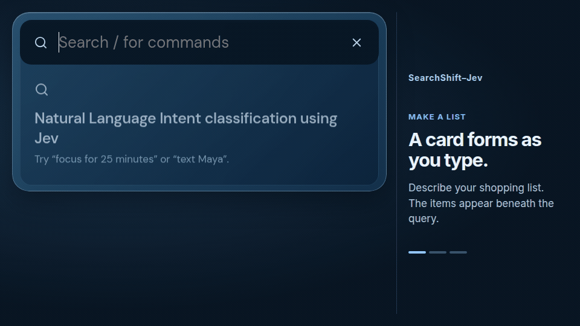
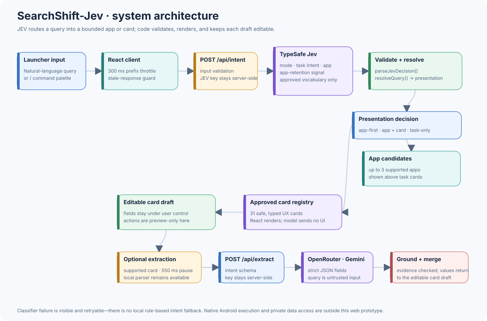
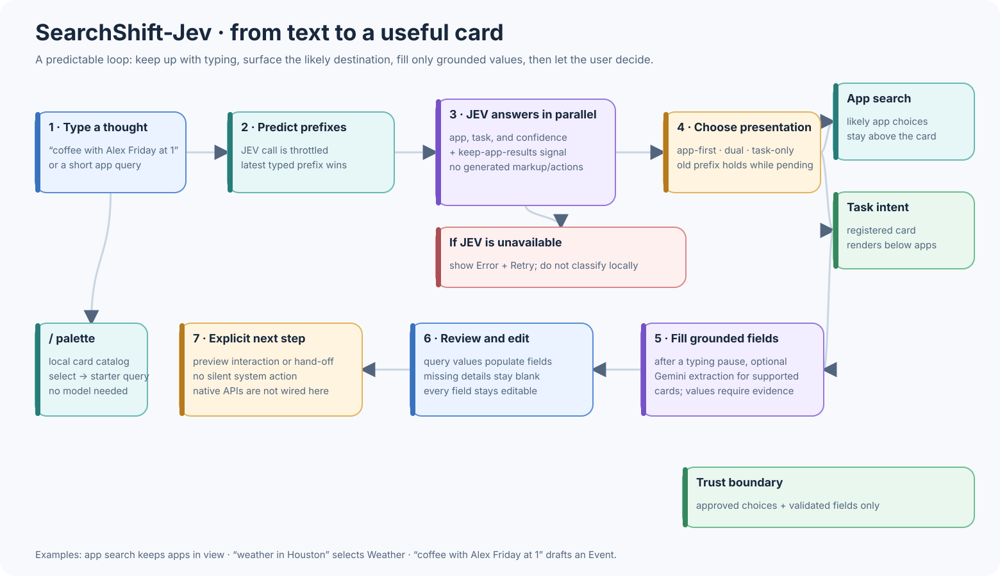

# SearchShift-Jev

**A phone-first launcher prototype that turns one natural-language search into an app suggestion or an editable task card.**



SearchShift-Jev explores a simple idea: start with what you want to do, not which app you need to open. Search for an app, describe a small task, or type `/` to browse the available cards. App suggestions stay above task cards while an app search is still plausible.

The classifier is [JEV](https://typesafe.ai/)'s job. The application validates its answer against a fixed vocabulary and renders the matching React component. Optional Gemini extraction can fill supported card fields from the query; the user can review and edit those values before taking the next step. Models choose among bounded options—they do not generate UI or execute actions.

## Try it

| Type | What SearchShift-Jev shows |
| --- | --- |
| `coffee with Alex Friday at 1` | Calendar remains available above an Event draft; title, person, day, and time can be filled from the text and edited. |
| `Spotify` | A likely app match, when returned by JEV, appears as an app candidate. |
| `/` | A searchable palette of 31 registered cards, grouped by everyday tasks, time and tools, find and go, and quick controls. |
| `find PDF of a workout plan I downloaded last week` | A file-search request card. It is a prototype preview, not a scan of the device’s files. |

The landscape demo above browses the command menu, finds Spotify, calculates `18% of 64`, creates a shopping checklist, and prepares a five-minute timer. It uses synthetic queries captured from the browser prototype.

## How it works

1. **Typing starts prediction.** The React client sends query prefixes through a roughly 300 ms throttle and ignores stale responses. It can keep the last useful result visible while a newer prefix is being classified.
2. **JEV classifies the query.** The browser posts to `/api/intent`; the server calls JEV with the approved task and app choices. The response is parsed and validated before it reaches the UI.
3. **The UI resolves the presentation.** SearchShift-Jev can show app candidates, a task card, or both. When app search is plausible, app candidates appear above the card. There is no local rule-based intent-classification fallback: if JEV fails, the interface shows an error and retry action.
4. **Cards come from a local registry.** Typing `/` opens that registry directly, without a classification request. Otherwise the validated intent selects a fixed React card; it cannot return markup or executable actions.
5. **Fields become an editable draft.** Local parsers handle supported values such as amounts, units, dates, and names. If configured, a separate OpenRouter/Gemini request can extract supported fields after about 550 ms without typing. Returned values are schema-checked and grounded in the query; missing or ungrounded values are left blank or rejected.
6. **The person decides what happens next.** Cards support preview interactions and editable fields. This web prototype does not invoke native Android APIs or silently create calendar events, messages, alarms, or device changes.

## Architecture

The intent boundary and optional field-extraction path are separate on purpose: JEV chooses *what kind of experience* to show; field extraction helps populate *that experience’s editable draft*.

<p align="center">
  
</p>

[Open the architecture drawing in Excalidraw](docs/diagrams/architecture.excalidraw)

<p align="center">
  
</p>

[Open the query lifecycle drawing in Excalidraw](docs/diagrams/query-lifecycle.excalidraw)

The diagrams are editable `.excalidraw` files; their SVG previews are checked in beside them. Regenerate both formats with:

```sh
node scripts/generate-doc-diagrams.mjs
```

## Card library

The command palette currently includes 31 registered prototypes:

- **Everyday:** checklist, reminder, quick note, calendar event, new contact, text or call, habit, and goal.
- **Time and tools:** timer, alarm, date countdown, time zone, unit converter, currency converter, bill split, calculator, calorie estimate, coin flip, and color picker.
- **Find and go:** file-search request, personal-info search plan, save link, directions, save parking, restaurant reservation, food order, and sports score.
- **Quick controls:** weather, device control, automation, and music search.

“Registered prototype” describes the UI and preview behavior, not a native integration. For example, the file-search card does not inspect local storage, the weather card does not fetch a live forecast, and device-control cards do not change phone settings. External search shortcuts open their corresponding web search.

## Run locally

Use Node.js 22 or newer and npm. Install dependencies:

```sh
npm install
```

Create an ignored `.env.local` file in the project root:

```dotenv
JEV_API_KEY=your_jev_api_key

# Optional: enables grounded field extraction for supported cards
OPENROUTER_API_KEY=your_openrouter_api_key
# Optional model override; defaults to google/gemini-3.1-flash-lite
OPENROUTER_FIELD_MODEL=google/gemini-3.1-flash-lite
```

Then start the Vite development server:

```sh
npm run dev
```

JEV is required for free-form intent classification. The `/` command palette can still be explored directly. In local development, Vite serves the `/api/intent` and `/api/extract` handlers; `api/intent.js` and `api/extract.js` provide the corresponding deployment handlers. Keep provider keys on the server—never put them in a `VITE_*` variable or commit `.env.local`.

Queries are sent to JEV for classification. When field extraction is enabled, supported query text is also sent to OpenRouter after the pause. Avoid entering sensitive personal information. Do not expose the extraction endpoint publicly without suitable authentication and rate limiting.

## Development and checks

```sh
npm run build        # TypeScript check and production build
npm run test:fields  # field parsing, schema, grounding, and failure-path tests
```

The intent evaluation scripts exercise the development-only classifier lab and make live JEV calls, so run them with the dev server and JEV key configured:

```sh
npm run evaluate:intents
npm run evaluate:prefixes
```

Cases live in `tests/intent-cases.json` and `tests/prefix-intent-cases.json`. The app is a Vite + React + TypeScript prototype, with its card implementations in `src/components/` and shared query parsing in `src/queryEntities.ts`.
